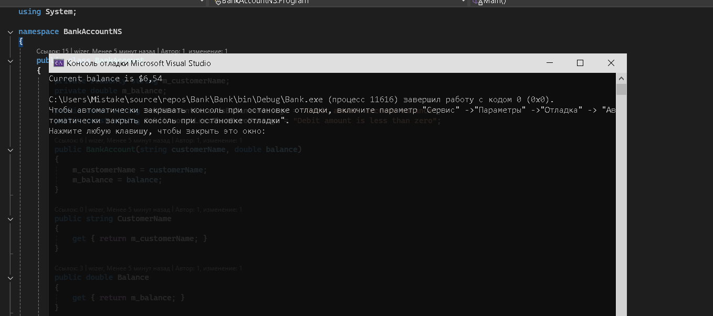
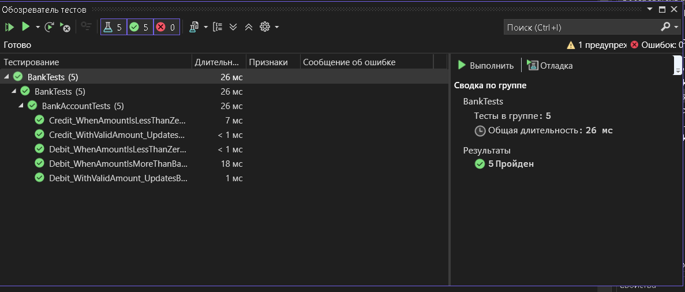

# ПР 6 часть1 (Банк)
## Выполнили: Арутюнов, Старшинов
### В ходе практической работы было выполнено автоматизированное модульное тестирование класса BankAccount в среде Microsoft Visual Studio. Были созданы тесты для методов Debit и Credit, проверяющие корректную работу методов и обработку ошибок. С помощью тестирования была обнаружена ошибка в методе Debit, где сумма списания прибавлялась к балансу вместо вычитания. После исправления и рефакторинга кода все тесты были успешно пройдены. Использование unit-тестов позволило повысить надежность и понятность программы.   

### Корректно работая программа

### Выполненные тесты

# Объяснение модульных тестов

## Тест 1  
### Debit_WithValidAmount_UpdatesBalance

Данный тест проверяет корректность работы метода `Debit` при передаче допустимой суммы.

**Логика теста:**

- Создается банковский счет с начальным балансом **11.99**.  
- Со счета снимается сумма **4.55**.  
- Ожидаемый баланс после операции должен составлять **7.44**.

После выполнения метода `Debit` происходит проверка фактического баланса счета.  
Если значение совпадает с ожидаемым, тест считается **успешно пройденным**.

Этот тест позволяет убедиться, что операция списания средств работает корректно.

---

## Тест 2  
### Debit_WhenAmountIsMoreThanBalance_ShouldThrowArgumentOutOfRange

Данный тест проверяет поведение программы при попытке снять сумму, превышающую текущий баланс.

**Логика теста:**

- Создается счет с балансом **11.99**.  
- Выполняется попытка снять **20.0**, что больше текущего баланса.  
- В этом случае метод `Debit` должен выбросить исключение `ArgumentOutOfRangeException`.

Тест проверяет, что:

- исключение действительно возникает;
- текст ошибки содержит сообщение  
  **"Debit amount exceeds balance"**.

Если исключение возникает корректно, тест считается **успешным**.

---

## Тест 3  
### Debit_WhenAmountIsLessThanZero_ShouldThrowArgumentOutOfRange

Данный тест проверяет ситуацию, когда передается отрицательная сумма списания.

**Логика теста:**

- Создается счет с балансом **11.99**.  
- Выполняется попытка снять **-100**.  
- Метод `Debit` должен выбросить исключение `ArgumentOutOfRangeException`, так как отрицательная сумма списания недопустима.

Тест также проверяет наличие сообщения:
`Debit amount is less than zero`

Если исключение возникает корректно, тест считается **успешным**.

---

## Тест 4  
### Credit_WithValidAmount_UpdatesBalance

Данный тест проверяет корректность работы метода `Credit` при пополнении счета.

**Логика теста:**

- Создается счет с балансом **11.99**.  
- Выполняется пополнение счета на **5.0**.  
- Ожидаемый баланс после операции должен составлять **16.99**.

После выполнения метода происходит проверка фактического баланса счета.  
Если значение совпадает с ожидаемым, тест считается **успешным**.

Этот тест подтверждает правильность работы метода пополнения счета.

---

## Тест 5  
### Credit_WhenAmountIsLessThanZero_ShouldThrowArgumentOutOfRange

Данный тест проверяет обработку ошибочной ситуации при попытке пополнить счет отрицательной суммой.

**Логика теста:**

- Создается счет с балансом **11.99**.  
- Выполняется попытка пополнить счет на **-5**.  
- Метод `Credit` должен выбросить исключение `ArgumentOutOfRangeException`.

Если исключение возникает корректно, тест считается **успешно выполненным**.